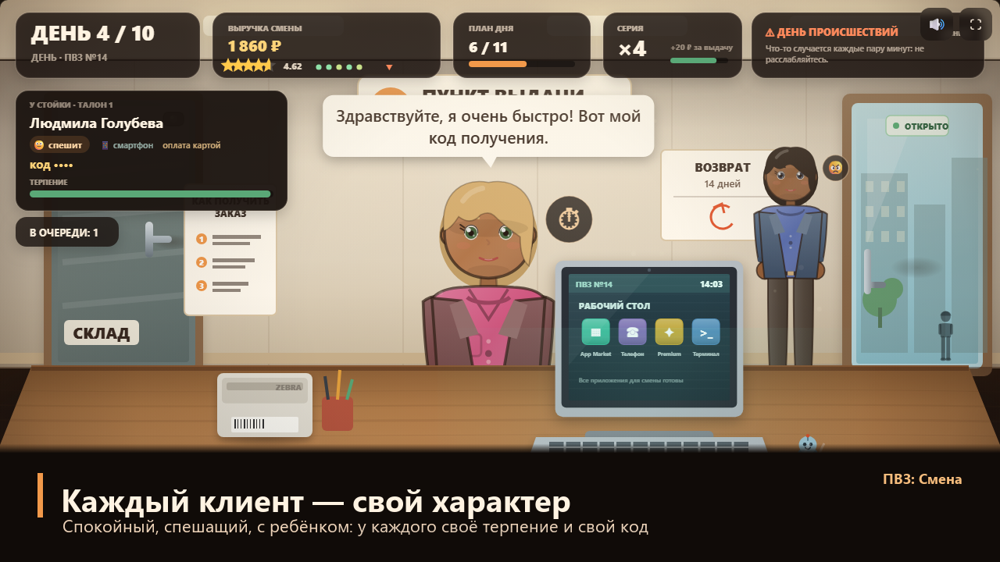
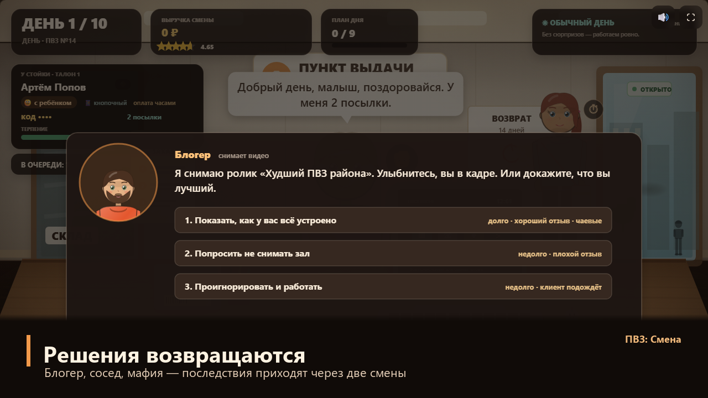
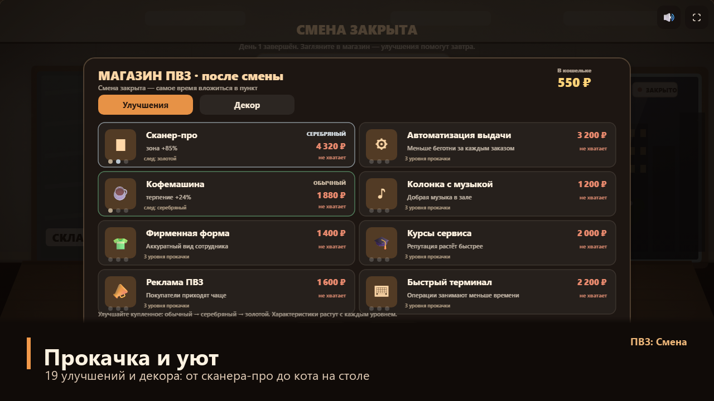
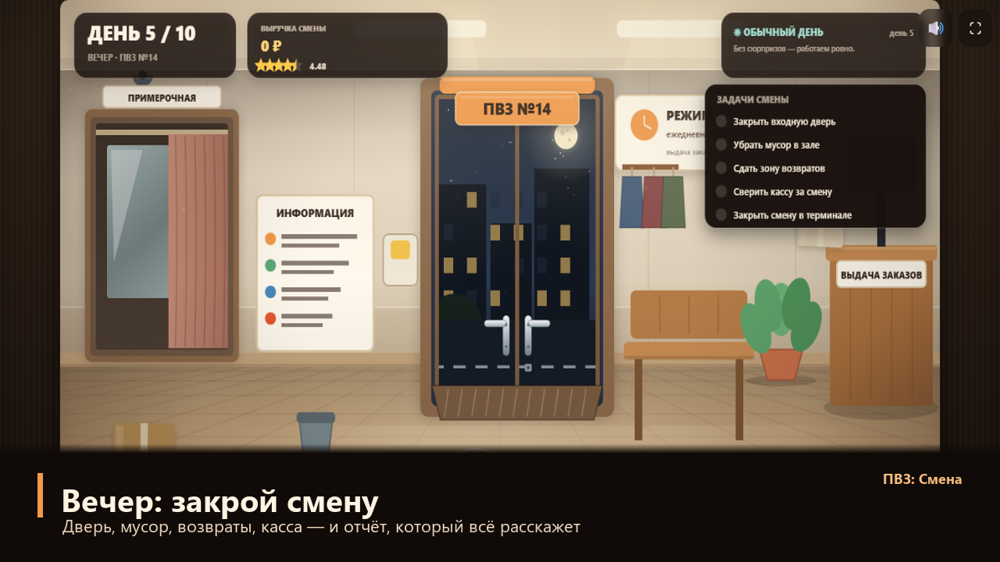
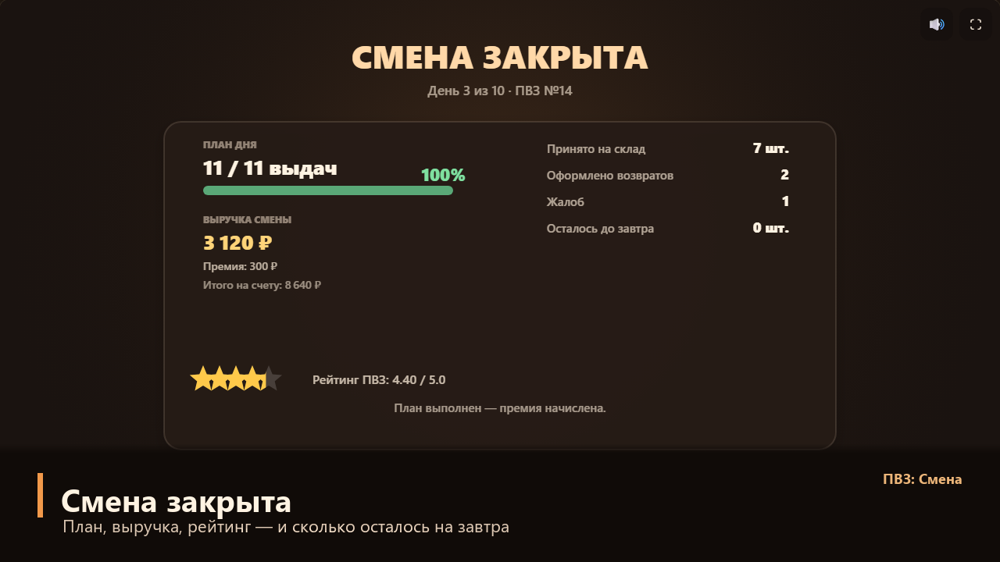

# ПВЗ: Смена

[](https://github.com/igorrais82/pvz-smena/releases)
[](https://github.com/igorrais82/pvz-smena/releases/latest/download/PVZ-Smena-win64.zip)
[](https://github.com/igorrais82/pvz-smena/releases/latest/download/PVZ-Smena.apk)
[](https://igorrais82.github.io/pvz-smena/game/index.html)



Симулятор работы в пункте выдачи заказов: приёмка поставки, выдача по коду, примерочная, возвраты, касса, отзывы, магазин улучшений и декора — плюс вечерний «оброк» мафии, которой вы задолжали.

Игра написана на чистом JavaScript и Canvas 2D: **без зависимостей, без сборки, без интернета**. Запускается двойным кликом по `game/index.html`, работает с `file://`.

## Скачать

| Платформа | Файл | Размер | Как запустить |
|---|---|---|---|
| **Windows 10/11** | [PVZ-Smena-win64.zip](https://github.com/igorrais82/pvz-smena/releases/latest/download/PVZ-Smena-win64.zip) | ~0,4 МБ | распаковать и запустить «Запустить ПВЗ.vbs» |
| **Android 7.0+** | [PVZ-Smena.apk](https://github.com/igorrais82/pvz-smena/releases/latest/download/PVZ-Smena.apk) | ~0,5 МБ | открыть APK и разрешить установку из этого источника |
| **Браузер** | [Играть онлайн](https://igorrais82.github.io/pvz-smena/game/index.html) | — | ничего скачивать не нужно |
| **Один файл** | [PVZ-Smena.html](https://github.com/igorrais82/pvz-smena/releases/latest/download/PVZ-Smena.html) | ~1 МБ | открыть в любом браузере, работает с флешки |

Все версии, исходники и история изменений — на [странице проекта](https://igorrais82.github.io/pvz-smena/) и в [релизах](https://github.com/igorrais82/pvz-smena/releases).

## Как играть

- **Цель** — продержаться 10 смен, не уронив рейтинг пункта ниже 3,00, и по возможности закрыть долг мафии (9 350 ₽).
- **Утро.** Включите свет в зале, откройте смену в терминале (`T`), примите поставку на складе (перетащите коробки в ячейки) и откройте входную дверь.
- **День.** Обслуживайте покупателей: отсканируйте код с телефона (или попросите продиктовать — тогда код нужно ввести в терминале вручную), возьмите посылку в ячейке, **положите её на стол**, возьмите сканер и отсканируйте штрихкод коробки (QTE), затем отдайте заказ. Каждый вариант ответа стоит времени, денег или репутации.
- **Рейтинг.** Это средняя оценка клиентов: довольный тянет её вверх, жалоба роняет сразу и заметно. В HUD рядом со звёздами видны оценки последних пяти визитов и стрелка тренда. Упало до 3,00 — пункт закрывают.
- **Последствия.** Решение возвращается через две смены: утром приходят «Новости пункта». Обидели блогера — ждите ролик, спасли ребёнка — ждите благодарность.
- **Темп.** Чем дальше, тем быстрее тает терпение покупателей. Держите серию выдач (бонус за каждую подряд), переживайте «час пик» с двойными чаевыми и учитывайте событие дня — у каждой смены свой характер.
- **Вечер.** Закройте дверь, уберите мусор, сдайте возвраты, сверьте кассу и закройте смену в терминале. После отчёта приходит мафия.
- **Магазин.** 19 предметов по три уровня каждый (обычный → серебряный → золотой). Улучшения ускоряют работу, декор повышает терпение покупателей, а «Автоматизация выдачи» убирает ручную рутину: лента привозит посылку к стойке, браслет считывает штрихкод, камера — код с телефона.

### Banana store

На **пятой смене** в пункт заходит мутный тип в странной одежде (`???`). После короткого разговора он ставит на ноутбук приложение **Banana store** — чёрный рынок. Его нет в App Market, зато оно есть в ноутбуке: там покупают травмат, яды и липовые документы, а ещё сбывают посылки со склада.

Сбыт приносит быстрые деньги, но рейтинг падает, а подозрение полиции растёт: продавать можно одну посылку в день. Когда подозрение доходит до **100%**, в зал действительно заходит полицейский: стучит, идёт от двери к стойке, показывает удостоверение и начинает разговор. Отрицать, показать ноутбук или попробовать откупиться — всё равно кончится наручниками и закрытием пункта. Антивирус «Щит» находит приложение и предлагает его удалить.

### Premium store

На ноутбуке **сразу стоит Premium store** — магазин премиальных покупок. Витрина поделена на три полки:

| Полка | Предложение | Цена | Было | Что даёт |
|---|---|---|---|---|
| Наборы | **Стартовый набор** | 249 ₽ | 1 595 ₽ (−84 %) | скины кота + пак приложений + «без рекламы» + 400 монет |
| Наборы | **ПВЗ Плюс · 30 дней** | 299 ₽ | 599 ₽ | −20 % на монеты, ×2 бонус за рекламу, подарок 15 монет в день |
| Наборы | **Набор «Профи»** | 799 ₽ | 2 984 ₽ | всё из стартового + 1 200 монет + 30 дней Плюса |
| Наборы | **Всё навсегда** | 1 990 ₽ | 7 637 ₽ | все товары + Плюс навсегда + 5 000 монет |
| Товары | **Без рекламы** | 149 ₽ / 135 🪙 | 299 ₽ | бонусные монеты без ролика (откат 6 секунд) |
| Товары | **Пак скинов на кота** | 199 ₽ / 180 🪙 | 399 ₽ | сиамский, смокинг, трёхцветный, голубой |
| Товары | **Пак приложений** | 249 ₽ / 225 🪙 | 499 ₽ | сразу ставит все приложения App Market |
| Товары | **Плюс на 7 дней** | 300 🪙 | — | пробная подписка за монеты |
| Монеты | 100 / 550 / 1 500 / 4 000 | 99 / 449 / 999 / 1 990 ₽ | — | +0 / +21 / +49 / +100 % бонуса |

Монеты дают за просмотр рекламного ролика (+1, с Плюсом и «Без рекламы» — до +3) или за демо-покупку за настоящие рубли. Платёжного шлюза нет: подтверждение честно помечено как «демо-оплата», деньги не списываются. Premium-покупки сохраняются и переживают новый забег; срок ПВЗ Плюса считается по реальному времени.

Витрина сделана «заметной» намеренно: карточки-хиты светятся, у предложений есть бейджи «ХИТ», «ЛУЧШАЯ ЦЕНА», «−74 %», зачёркнутые старые цены и строка «выгода N ₽», а на рабочем столе ноутбука ярлык Premium store подсвечен золотом с бейджем «−84 %», пока не куплен стартовый набор.

Как подключается настоящий платёж — в разделе [«Донат и платежи»](#донат-и-платежи).

### Артём и звонок Босса

**Артём** — друг из соседнего пункта — приходит **через смену утром** (дни 2, 4, 6, 8, 10) просто поболтать. Можно поболтать о жизни, спросить совета про мафию, угостить его кофе (следующий покупатель будет терпеливее) или извиниться и вернуться к работе. Он есть в контактах телефона и в «Мессенджере».

На **девятой смене** звонит телефон Артёма: в трубке — **голос Босса**. Выбор — слушать, спросить, что с другом, или сбросить — меняет доверие мафии, грязь и улики.

### Радио ПВЗ

В приложении «Радио ПВЗ» — меню из семи эфиров: «Тишина», Lo-Fi, «Радио ПВЗ», «Ночной эфир», «Джаз-кафе», «8-бит смена» и «Классика». У каждой станции свой темп, лад, тембры и мелодия; музыка синтезируется на лету. Громкость регулируется полосой в плеере, выбор сохраняется.

### Код в терминале

Если покупатель **забыл телефон** и диктует код, его нужно **ввести в терминале вручную** — код показывается как подсказка «На слух», но заказ терминал найдёт только после ввода. Это единственный способ узнать ячейку в таком случае.

### Сюжет мафии

Долг — это не только вечерний оброк. На второй смене появляется **куратор Костя** и ставит на ноутбук приложение **«Долги»**; на третьей он приносит ящик без накладной, на шестой Громила просит переждать рейд, на седьмой Босс предлагает работать на него, на восьмой участковый предлагает сделку.

Каждый вечерний визит — **разговор с выбором**: отдать как просили, попросить отсрочку под проценты, отработать услугой (смена «под присмотром»: 8 клиентов в обмен на долг) или намекнуть на полицию, если собрано хотя бы две улики. Три шкалы — **доверие**, **грязь** и **улики** — решают, каким будет финал: «Свободен», «Свой человек», «Стукач», «По уши в грязи» или «Долг остался».

### Событие дня

Каждое утро выбирается одно из **15 обстоятельств** и меняет правила смены: дождь, жара, распродажа, праздник, день проверки, поставки, возвратов, инвентаризация, стажёр, перебои со светом, день зарплат, мороз, день происшествий, тихий день. Один и тот же день подряд не выпадает.

### Бесконечный режим

Мафии в нём нет, смены не кончаются — можно прожить хоть 100 смен, хоть 10 000. Вместо оброка каждый вечер приходит **арендодатель**: фиксированная ставка (160 ₽ + 18 ₽ за смену, потолок 4 200 ₽, +12 % каждые 10 смен) плюс **доля выручки смены** (9 %, +1 % каждые 10 смен, максимум 25 %). Доля выручки держит аренду посильной на любой длине забега.

Не хватило денег — остаток переходит на следующую смену (в HUD и отчёте видно «Долг по аренде»). Три неоплаты подряд — выселение и конец забега; полная оплата сбрасывает счётчик. Рекорд по сменам и деньгам сохраняется. Кнопка режима — в главном меню.

### Управление

| Действие | Клавиатура | Мышь/тап |
|---|---|---|
| Склад ↔ стойка | `←` | дверь слева |
| Зал | `→` | дверь справа |
| Терминал | `T` | ноутбук → Терминал |
| Ноутбук | `L` | ноутбук на столе |
| Выбор в диалоге | `1`–`4` | нажать вариант |
| Положить посылку на стол / сканировать | `Enter` / `Пробел` | нажать на место под посылку слева на столе |
| Пауза | `Esc` | — |
| Меню разработчика | `` ` `` / `ё` | кнопка `DEV` (убирается перед релизом) |

### Телефон и планшет

Игра работает в ландшафте на телефоне: при ширине окна меньше 1000 px включается компактный интерфейс — крупный HUD одной строкой, полноэкранные диалоги, увеличенный магазин и меню. Поля вокруг 16:9 залиты тёплым фоном, поэтому на 20:9-экранах не выглядят обрезанными. Если текст всё ещё мелкий, масштаб можно поднять вручную: `?ui=1.3` (до 1.6).

Для Android есть готовая WebView-сборка: [PVZ-Smena.apk](https://github.com/igorrais82/pvz-smena/releases/latest/download/PVZ-Smena.apk) (Android 7.0+, landscape, без интернета). Браузерная версия на GitHub Pages кэшируется service worker'ом (`game/sw.js`) и запускается офлайн после первого открытия.

## Скриншоты

<p align="center">
  
  
</p>
<p align="center">
  
  
</p>

Больше кадров и кнопки скачивания — на [странице проекта](https://igorrais82.github.io/pvz-smena/).

## Пасхалки

В игре спрятано **16 секретов**: 12 редких гостей (Геральт, Тёмный лорд, Шерлок, доктор Хаус, Уолтер Уайт, Гэндальф, Марио, Соник, Тёмный рыцарь, Шелдон, Бонд, Дед Мороз) и 4 интерактивных секрета (кружка на столе, фигурки, кот, Konami-код). Найденные собираются в приложении **«Секреты»** на ноутбуке — оно открывается вместе с первой находкой.

Пасхалки не влияют на прохождение: это награда за любопытство, за каждый секрет дают деньги, репутацию и строчку в коллекции.

## Запуск и разработка

```bash
# просто открыть игру
start game/index.html            # Windows
xdg-open game/index.html         # Linux

# дымовой тест сцен в Node без браузера
npm run smoke

# проверка Premium store, радио, Артёма, звонка Босса и кода в терминале
node tools/probe-v15.js

# статическая сборка dist/game (для WebView-контейнера и сайта)
npm run build

# один автономный HTML-файл (~1 МБ) для флешки и любого браузера
npm run build:single

# портативная сборка Windows: папка + лаунчер + ZIP
npm run build:pc

# Android APK (нужны JDK 17+ и Android SDK: platform 35, build-tools 35)
npm run build:android

# всё сразу: dist/game, HTML, ZIP и APK
npm run build:all

# скриншоты и прогоны в headless Chrome (нужен установленный Chrome/Edge)
npm run shots
npm run review

# кадры для проверки новых механик (живой рейтинг, последствия, бесконечный режим)
node tools/cdp.js "file:///<путь>/game/index.html?dev=day&mode=hud" shots/new-hud.png --evalfile=tools/verify-shots.js
```

Требуется только Node.js 18+ (для тестов и сборок) и браузер. Никаких `npm install` — зависимостей нет. Для APK дополнительно нужны JDK 17+ и Android SDK; Gradle скачивается при первой сборке (или берётся из кэша).

## Структура

```
game/
  index.html        точка входа, подключает скрипты по порядку
  style.css         канвас, фуллскрин, поле ввода названия ПВЗ
  manifest.webmanifest  PWA-манифест для установки из браузера
  sw.js             офлайн-кэш браузерной версии (только https)
  src/core.js       утилиты, звук и музыка (WebAudio, без файлов), ввод, сохранения, тарифы
  src/pay.js        платёжный слой: demo / RuStore Billing / платёжная страница
  src/art.js        вся векторная графика: интерьеры, люди, реквизит, HUD
  src/systems.js    каталог товаров, заказы, ячейки, покупатели, диалоги, QTE, магазин, мафия, аренда, последствия, пасхалки
  src/apps.js       приложения ноутбука и App Market, Premium store, радио и экраны программ
  src/scenes.js     сцены: меню, смена (утро → день → вечер), отчёт, магазин, мафия, пролог, финал
  src/main.js       цикл, пауза, переходы, разрешение, текст, отладочные входы
android/            Gradle-проект Android-обёртки (WebView, landscape, кнопка «Назад»)
index.html          страница проекта: описание, скриншоты и скачивание (GitHub Pages)
landing.css         стили страницы проекта
tools/              smoke-тест, headless-скриншоты, сценарные прогоны и сборки
tools/build.js      статическая сборка dist/game
tools/build-single.js  один автономный HTML-файл
tools/build-pc.js   портативный ZIP для Windows с лаунчером
tools/build-android.js  сборка и подпись APK
tools/lib/zip.js    минимальный ZIP-архиватор без зависимостей
assets/             иконки приложения
store/              готовые скриншоты 16:9 с подписями и иконка 512 для карточки RuStore
shots/              скриншоты и артефакты прогонов (в git не входят)
dist/               готовые сборки: HTML, ZIP и APK (артефакты в git не входят)
```

## Отладочные входы

`game/index.html?dev=day | warehouse | rack | terminal | laptop | shop | evening | report | mafia | intro | tutorial` — сразу открывает нужную сцену. Параметр `?ui=1.2` форсирует масштаб текста (для проверки мобильной вёрстки), `?clean=1` скрывает кнопку DEV — так снимаются кадры для `store/`, `?pay=demo|rustore|web` выбирает платёжного провайдера. В меню разработчика (`` ` ``) есть кнопка **«Спавн кота»**: она приводит кошку с котёнком, если кота ещё нет.

## Донат и платежи

### Что уже есть в коде

Донат — это приложение **Premium store** на ноутбуке. Витрина (`game/src/apps.js`, блок `PREMIUM_ITEMS`), покупки (`premiumBuy`, `premiumGrant`, `premiumCheckout`) и платёжный слой (`game/src/pay.js`, объект `PVZ.pay`) разделены специально: цены и товары можно менять, не трогая платежи.

`PVZ.pay.buy({ sku, title, price, currency }, done)` — единственная точка, через которую проходят покупки за рубли. Провайдер выбирается в конфиге:

```js
PVZ.pay.configure({
  provider: 'demo',        // demo | rustore | web
  endpoint: '',            // база вашего платёжного API для provider: 'web'
  testMode: true,          // demo: покупка проходит без денег
  verifyUrl: ''            // необязательно: POST-проверка чека на сервере
});
```

Конфиг можно положить до подключения скриптов (`window.PVZ_PAY_CONFIG = {...}`) или выбрать провайдера параметром адреса: `?pay=demo|rustore|web` — удобно для проверки на устройстве. По умолчанию — `demo`: интерфейс честно пишет «демо-оплата», деньги не списываются, товар выдаётся сразу.

### Что нужно подключить

**1. Аккаунт продавца и товары.** В магазине приложений (RuStore, Google Play) донаты продаются как встроенные покупки: заводятся товары с теми же `sku`, что в коде, — `premium.starter`, `premium.plus30`, `premium.coins100` и т. д. (см. `apps.PREMIUM_ITEMS`). Цены в консоли — источник истины; в игре они должны совпадать.

**2. RuStore Billing (рекомендуется для RuStore).** В игре уже есть провайдер `rustore`: он зовёт мост из Android-обёртки:

```js
window.RuStoreBilling = {
  purchase: function (json) {
    // json = { productId, title, price, currency }
    // вернуть строку или объект: { status: 'success', purchaseId, receipt }
    return JSON.stringify({ status: 'success', purchaseId: '...', receipt: '...' });
  }
};
```

Мост пишется на стороне Android-контейнера (WebView + `RuStore BillingClient`): метод `purchase` запускает покупку, получает `Purchase` и отдаёт игре `purchaseId` и чек. Если моста нет, `PVZ.pay` не выдаёт товар, а пишет «RuStore Billing не подключён» — так исключены бесплатные покупки.

**3. Свой платёжный сервер (веб, ЮKassa, CloudPayments, Т-Банк).** Провайдер `web` делает `POST {endpoint}/create` с `{ orderId, sku, title, price, currency }`, ждёт `{ paymentUrl }`, открывает ссылку на оплату (`window.pvzOpenPayment(url, orderId)` в обёртке или новая вкладка) и опрашивает `GET {endpoint}/status?orderId=…` до `{ status: 'paid', receipt }`. Минимум сервера:

- создать платёж в API кассы и вернуть ссылку;
- принять вебхук кассы и пометить заказ оплаченным;
- отдавать статус только после подтверждения вебхука.

**4. Проверка чека.** Задайте `verifyUrl` — тогда после оплаты игра отправляет `{ sku, price, receipt }` на сервер и выдаёт товар только при `{ valid: true }`. Иначе чек можно подделать правкой JS/localStorage: сейв лежит в `localStorage`, и все деньги/покупки — это клиентские данные.

**5. Античит и выдача.** Идеальная схема: сервер хранит покупки (`userId → sku`), клиент при старте получает список купленного и выдаёт его; клиентская запись в `localStorage` — только кэш. Это же спасает от потери покупок при переустановке.

### Юридическая часть (РФ)

- Публичная **оферта** и правила покупки виртуальных товаров; кнопка оплаты не должна вводить в заблуждение (сейчас в демо-режиме честно написано «демо-оплата»).
- **Чек по 54-ФЗ** на каждую покупку (касса/облачная касса, фискализация), возвраты и поддержка — почта в оферте.
- **Возрастной рейтинг** и маркировка рекламы, если в игре есть рекламные вставки.
- Комиссия магазина (RuStore/Google Play) и налоги — закладывайте в цену: из 249 ₽ до автора доходит меньше.
- Не продавайте «убрать рекламу», если рекламы нет: в текущей витрине этот товар даёт конкретную механику (бонус без ролика), а не пустое обещание.

### Как проверить интеграцию

```bash
# демо-оплата (по умолчанию) — вся витрина работает без денег
start game/index.html?pay=demo

# провайдер выбран, но моста нет — покупка должна честно упасть
start game/index.html?pay=rustore

# тесты витрины и платёжного слоя
node tools/probe-v15.js
node tools/smoke.js
```

## Публикация в RuStore

Кнопка `DEV` и читы (`scenes.js`, объект `api.debug`) — отладочные. Перед сборкой релиза их нужно убрать или закрыть проверкой `location.search`. Игра — статический сайт: для RuStore заворачивается в WebView-контейнер (ориентация landscape, fullscreen, без доступа в сеть). Манифест для PWA лежит в `game/manifest.webmanifest`, офлайн-кэш — в `game/sw.js`.

Готовая Android-обёртка лежит в `android/`: `npm run build:android` собирает подписанный release-APK и кладёт его в `dist/`. Подробности про ключ, SDK и обновления — в [android/README.md](android/README.md).

Комплект для карточки уже собран: иконка 512×512 и пять скриншотов 16:9 с подписями — в `store/`. Пересобрать: `python tools/make-icon.py` и `python tools/make-store-shots.py` (нужен Pillow). Требования RuStore: иконка 512×512, минимум 3 скриншота 16:9.

## Лицензия

Код и графика — собственная работа автора. Отсылки к персонажам игр, фильмов и сериалов — это пародийные пасхалки; права на персонажей принадлежат их правообладателям.
